<div align="center">

# 🛒 Supermercado ABC: Dados, Gráficos e Machine Learning

### 100 mil vendas · 11 gráficos · 5 modelos · zero Pandas


[**▶ Abrir no Colab**](https://colab.research.google.com/github/USUARIO/REPO/blob/main/Aula-14-Visualizacao-de-Dados-Polars.ipynb) · [Parte 1](#-parte-1--visualização-de-dados-aula-14) · [Parte 2](#-parte-2--interpretação-de-modelos-knn-aula-15) · [Como rodar](#-como-rodar)

<sub>UniCEUB · Aulas 14 e 15 · Visualização de Dados e Interpretação de Modelos</sub>

</div>

---

## 🎯 Sobre o projeto

Um único notebook com **duas etapas** sobre as vendas de uma rede de supermercados, tudo refeito com **Polars** no lugar de Pandas:

| Parte | Aula | O que faz |
|---|---|---|
| **1** | Aula 14 | Análise exploratória (EDA) e **8 visualizações** com Matplotlib e Seaborn |
| **2** | Aula 15 | **KNN** para prever a categoria do produto e, principalmente, **interpretar** o resultado: acurácia, precision/recall/F1, matriz de confusão e melhorias |

O Polars faz leitura, limpeza e agregação; o scikit-learn recebe os arrays via `.to_numpy()`.

## 📊 O dataset em números

| | |
|---|---|
| 🧾 **Itens vendidos** | 100.000 |
| 🛍️ **Vendas (cupons)** | 32.995 |
| 👥 **Clientes únicos** | 19.859 |
| 🏬 **Filiais** | 5 |
| 📦 **Produtos distintos** | 18 |
| 💰 **Valor líquido total** | ≈ R$ 4,68 milhões |
| 📅 **Período** | 01/01/2025 → 31/08/2026 |
| 🧹 **Valores nulos** | 0 |

**Colunas (23):** `id_item`, `id_venda`, `data_hora`, `filial_id`, `filial`, `cidade`, `estado`, `caixa`, `operador_caixa`, `id_cliente`, `segmento_cliente`, `produto`, `categoria`, `subcategoria`, `marca`, `quantidade`, `preco_unitario`, `desconto_valor`, `valor_liquido`, `custo_total`, `imposto`, `comissao`, `forma_pagamento`.

**Distribuição das categorias (desbalanceada):**

| Categoria | Itens | % |
|---|---|---|
| Alimentos | 48.215 | 48,2% |
| Bebidas | 17.013 | 17,0% |
| Limpeza | 13.907 | 13,9% |
| Higiene | 10.843 | 10,8% |
| Eletrônicos | 10.022 | 10,0% |

---

## 📈 Parte 1 · Visualização de Dados (Aula 14)

### 🔍 O que os dados mostram

- 📱 **Eletrônicos e Alimentos dominam:** juntas, as duas categorias respondem por cerca de **78%** do valor líquido (Eletrônicos ≈ 44%, Alimentos ≈ 34%), mesmo com os eletrônicos vendendo bem menos itens.
- 💳 **Cartão de Crédito lidera** as formas de pagamento (≈ 34% do valor), seguido pelo **PIX** (≈ 27%).
- 🍚 **Arroz 5kg** é o produto mais frequente, com 11.512 registros.
- 📉 O valor líquido é **muito assimétrico**: a maioria dos itens é barata e uns poucos itens de ticket alto puxam a cauda, como o histograma e o boxplot deixam claro.

### 🖼️ Galeria

<table>
  <tr>
    <td align="center"><b>Vendas por categoria</b><br>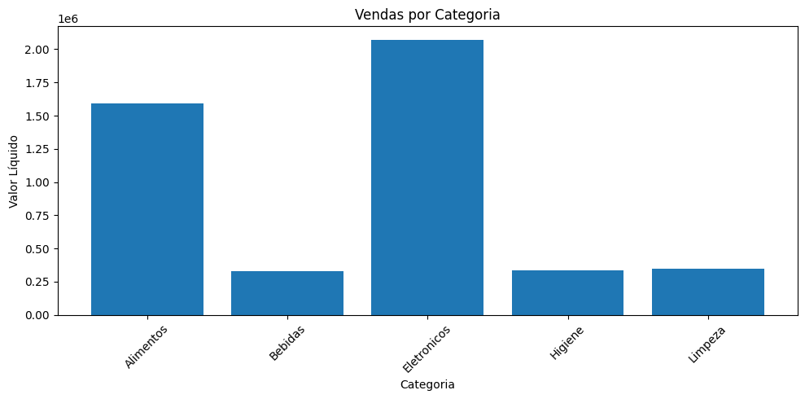</td>
    <td align="center"><b>Vendas por forma de pagamento</b><br>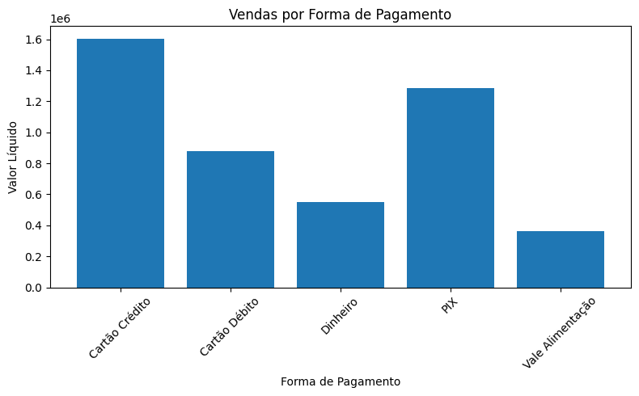</td>
  </tr>
  <tr>
    <td align="center"><b>Distribuição do valor líquido</b><br>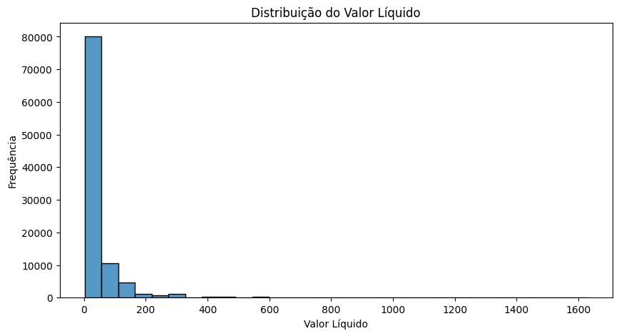</td>
    <td align="center"><b>Boxplot do valor líquido</b><br>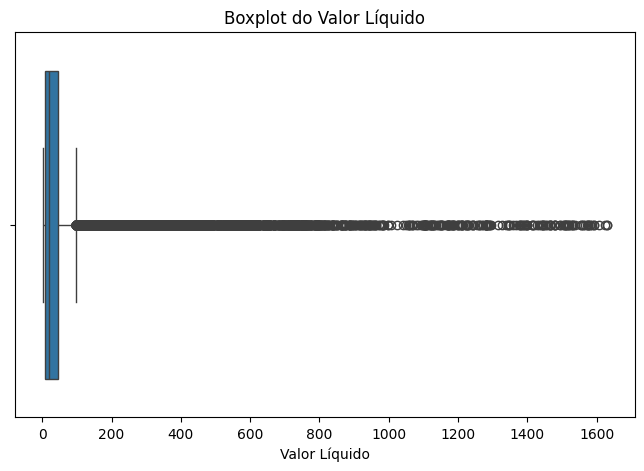</td>
  </tr>
  <tr>
    <td colspan="2" align="center"><b>Vendas ao longo do tempo</b><br>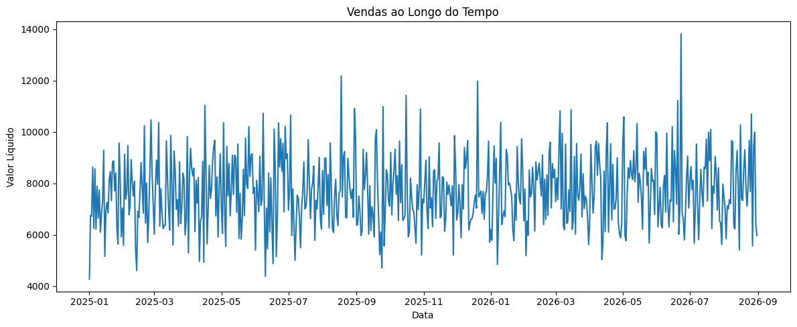</td>
  </tr>
  <tr>
    <td align="center"><b>Top 10 produtos mais vendidos</b><br>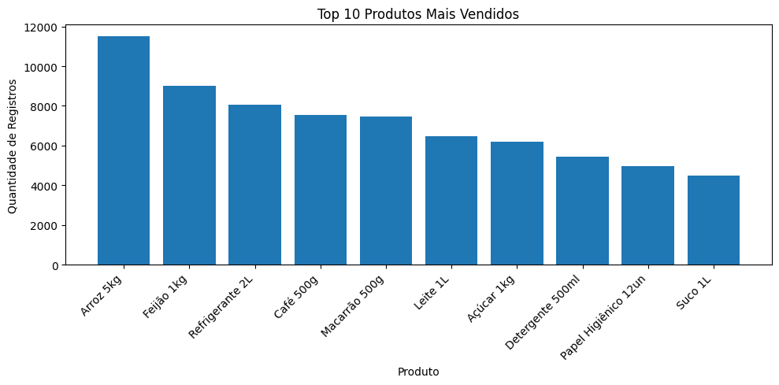</td>
    <td align="center"><b>Valor líquido médio por categoria</b><br>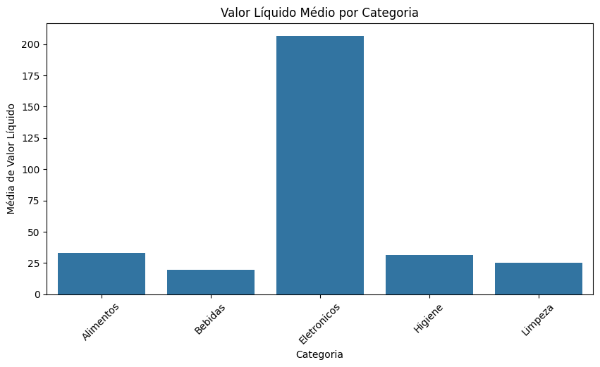</td>
  </tr>
  <tr>
    <td colspan="2" align="center"><b>Preço unitário × valor líquido (amostra de 1.000)</b><br>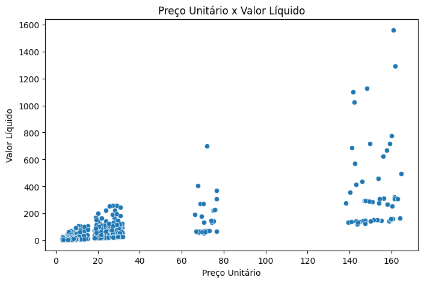</td>
  </tr>
</table>

---

## 🤖 Parte 2 · Interpretação de Modelos KNN (Aula 15)

**Pergunta:** dá para prever a **categoria** de um produto usando as demais variáveis da venda?

**Setup:** KNN (k=5), 75% treino / 25% teste com `stratify`, dados padronizados com `StandardScaler`.

### 🧪 Resultado do modelo da aula

| Categoria | Precision | Recall | F1 |
|---|---|---|---|
| Alimentos | 0,62 | 0,87 | 0,72 |
| Bebidas | 0,48 | 0,35 | 0,40 |
| Eletrônicos | 0,92 | 0,76 | 0,83 |
| Higiene | 0,35 | 0,19 | 0,24 |
| Limpeza | 0,36 | 0,14 | 0,20 |
| **Acurácia geral** | | | **59,6%** |

### 🧠 Como interpretar

- **A acurácia sozinha engana.** Prever sempre "Alimentos" já acertaria **48,2%**. O KNN (59,6%) só supera isso por pouco.
- **Eletrônicos vai bem** porque o preço alto separa essa classe das demais.
- **Higiene e Limpeza vão mal:** o modelo perde mais de 80% dos itens reais dessas classes.
- **A matriz de confusão mostra o padrão de erro:** Bebidas, Higiene e Limpeza são previstos como **Alimentos** em 55% a 63% dos casos.

<table>
  <tr>
    <td align="center"><b>Precision, Recall e F1 por categoria</b><br>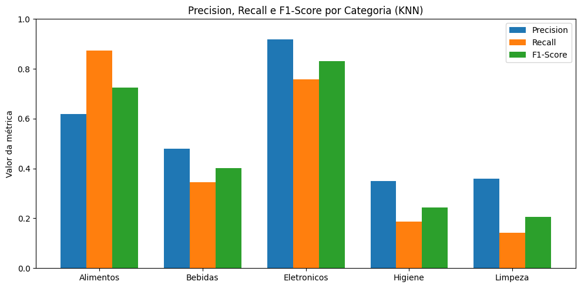</td>
    <td align="center"><b>Comparação de modelos</b><br>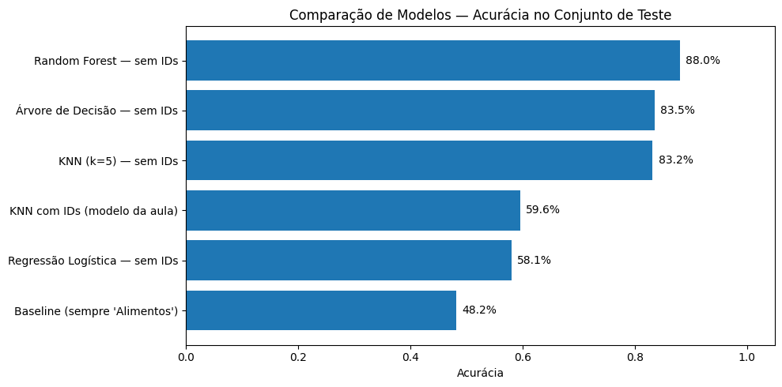</td>
  </tr>
  <tr>
    <td colspan="2" align="center"><b>Matriz de confusão (contagem e % por classe real)</b><br>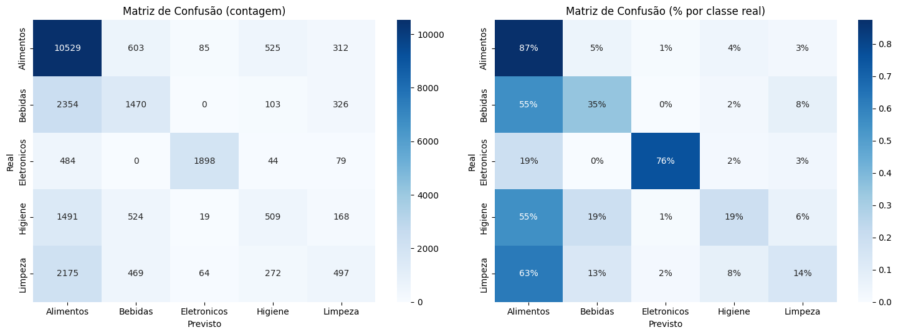</td>
  </tr>
</table>

### 💡 O problema é o algoritmo ou os dados?

`filial_id`, `caixa` e `id_cliente` são **identificadores**: o número do caixa não diz nada sobre a categoria do produto, mas entram no cálculo de distância do KNN. Removendo só essas 3 colunas:

| Modelo | Acurácia |
|---|---|
| Baseline (sempre "Alimentos") | 48,2% |
| KNN da aula (com IDs) | 59,6% |
| Regressão Logística (sem IDs) | 58,1% |
| KNN (sem IDs) | **83,2%** |
| Árvore de Decisão (sem IDs) | 83,5% |
| Random Forest (sem IDs) | **88,1%** |

> **Conclusão:** limpar os dados rendeu cerca de **+24 pontos** sem trocar o algoritmo. Trocar para Random Forest somou mais ~5. É o clássico *"garbage in, garbage out"*. Um modelo ruim não é fracasso, é **informação**.

---

## 🚀 Como rodar

### Opção 1: Google Colab (zero instalação)

1. Clique em **▶ Abrir no Colab** lá no topo.
2. Execute as células na ordem.
3. Quando a célula de leitura pedir, selecione o `supermercado_abc_100k_variado.csv`.

> O scikit-learn já vem instalado no Colab, assim como o Polars. Se faltar algo, rode `!pip install polars scikit-learn`.

### Opção 2: Localmente

```bash
# 1. Clone o repositório
git clone https://github.com/USUARIO/REPO.git
cd REPO

# 2. (opcional) crie um ambiente virtual
python -m venv .venv
source .venv/bin/activate      # Windows: .venv\Scripts\activate

# 3. Instale as dependências
pip install -r requirements.txt

# 4. Abra o notebook
jupyter notebook Aula-14-Visualizacao-de-Dados-Polars.ipynb
```

> 💡 Coloque o arquivo `supermercado_abc_100k_variado.csv` na mesma pasta do notebook.

## 🗺️ Roteiro do notebook

| # | Etapa | O que acontece |
|---|---|---|
| 1–4 | Leitura e estrutura | `read_csv`, `schema`, `null_count()`, `with_columns`, `describe()` |
| 5–6 | Barras | Vendas por categoria e por forma de pagamento |
| 7–8 | Distribuição | Histograma e boxplot (Seaborn) |
| 9–10 | Série temporal | Vendas por dia |
| 11–13 | Ranking, média e correlação | Top 10 produtos, média por categoria, dispersão |
| 15 | Preparação do ML | Extrai o número de `F04`, `CX02`, `CLI016985` com `str.extract` |
| 16 | KNN | Célula 34 da aula: split, scaler, modelo, avaliação |
| 17 | Acurácia | Comparada com o baseline da classe majoritária |
| 18 | Precision / Recall / F1 | Tabela em Polars + gráfico por classe |
| 19 | Matriz de confusão | Heatmap em contagem e em % |
| 20–21 | Diagnóstico e melhorias | KNN sem IDs e comparação de 4 algoritmos |
| 22 | Conclusão | Algoritmo ou dados? |

## 🔄 Pandas → Polars (cola rápida)

| Pandas | Polars |
|---|---|
| `pd.read_csv(...)` | `pl.read_csv(...)` |
| `df.info()` | `df.schema` / `df.null_count()` |
| `pd.to_datetime(df["col"])` | `pl.col("col").str.to_datetime()` |
| `df["x"] = ...` | `df.with_columns(...)` |
| `df.groupby("c")["v"].sum()` | `df.group_by("c").agg(pl.col("v").sum())` |
| `s.value_counts()` | `s.value_counts(sort=True)` |
| `df.sample(n, random_state=42)` | `df.sample(n, seed=42)` |
| `df[cols].values` | `df.select(cols).to_numpy()` |
| `df.plot(...)` | ❌ não existe, use Matplotlib/Seaborn |

### ⚠️ Pegadinhas que o notebook já resolve

- **`group_by` não ordena.** Sem `.sort(...)`, a linha do tempo sai embaralhada.
- **Polars não tem `.plot()` nativo.** As colunas vão para o Matplotlib/Seaborn via `.to_numpy()` ou `.to_list()`.
- **`strict=False`** nas conversões equivale ao `errors="coerce"` do Pandas: o que não converte vira `null`.
- **Colunas de código em texto** (`F04`, `CX02`) quebram o scikit-learn; o notebook extrai a parte numérica antes de treinar.

## 📁 Estrutura do repositório

```
.
├── Aula-14-Visualizacao-de-Dados-Polars.ipynb   # notebook (Parte 1 + Parte 2)
├── supermercado_abc_100k_variado.csv            # dataset
├── requirements.txt                             # dependências
├── images/                                      # gráficos usados no README
│   ├── 01_... a 08_...                          # Parte 1
│   └── p2_metricas, p2_matriz, p2_comparacao    # Parte 2
└── README.md
```

## 🛠️ Tecnologias

- **[Polars](https://pola.rs/)**: leitura, transformação e agregação dos dados
- **[scikit-learn](https://scikit-learn.org/)**: KNN, métricas, split e padronização, além dos modelos comparados
- **[Matplotlib](https://matplotlib.org/)** e **[Seaborn](https://seaborn.pydata.org/)**: gráficos
- **[Jupyter](https://jupyter.org/) / [Google Colab](https://colab.research.google.com/)**: ambiente de execução

## 🔭 Próximos passos

- [ ] Variar o `k` do KNN (3, 7, 15...) e escolher por validação cruzada
- [ ] Tratar o desbalanceamento (`class_weight="balanced"`, reamostragem)
- [ ] Criar features novas: margem (`valor_liquido - custo_total`) e % de desconto
- [ ] Ver a importância das variáveis no Random Forest (`feature_importances_`)
- [ ] Margem de lucro por categoria e ranking de filiais e operadores
- [ ] Migrar para `scan_csv` + `LazyFrame` e medir o ganho de desempenho

## 📚 Créditos

Notebooks originais: **Aula 14 (Visualização de Dados com Python)** e **Aula 15 (Interpretação de Modelos KNN na Prática)**, UniCEUB. Esta versão adapta o roteiro para Polars, adiciona checagem de nulos, ordenação explícita nas agregações e a análise de identificadores como fonte de ruído.

---

<div align="center">

Feito com 🐍 e ⚡ Polars

⭐ Se ajudou, deixa uma estrela no repo!

</div>
